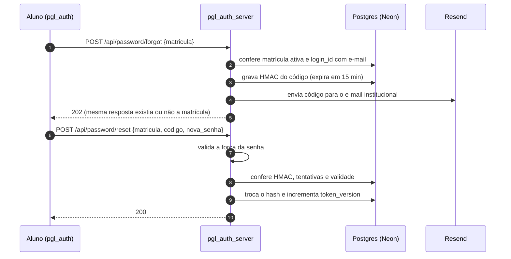
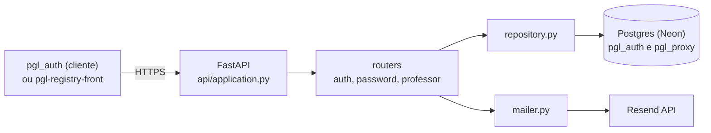

# pgl_auth_server

      

API serverless (FastAPI) hospedada no Vercel. Autentica alunos por matrícula e senha,
emite um token JWT de 4 horas para o proxy dos modelos de IA, e oferece:

- cadastro com matrícula numérica, e-mail institucional e senha forte;
- troca de senha pelo aluno, autenticado com a senha atual;
- redefinição de senha por código enviado ao e-mail institucional;
- bloqueio temporário após tentativas incorretas;
- revogação de sessões (logout e troca de senha);
- painel de professor: listar alunos, bloquear/desbloquear contas e enviar convites.

O pacote que os alunos instalam (`pgl-auth`) fica no repositório `pgl_auth`.

## Rotas

| Método e caminho | Quem usa | Descrição |
| --- | --- | --- |
| `POST /api/login` | aluno, professor | Valida matrícula e senha e devolve o token. |
| `POST /api/register` | aluno | Primeiro cadastro da senha. Exige matrícula, e-mail, senha e confirmação. |
| `POST /api/logout` | aluno | Revoga todos os tokens do aluno. |
| `POST /api/password/change` | aluno (token) | Troca a senha informando a senha atual. Devolve um token novo. |
| `POST /api/password/forgot` | aluno | Envia um código de 6 dígitos ao e-mail institucional. Sempre responde `202`. |
| `POST /api/password/reset` | aluno | Define a nova senha com o código recebido. |
| `POST /api/reset-password` | professor (token) | Define ou redefine a senha de um aluno. |
| `GET /api/professor/students` | professor (token) | Lista a turma com o estado de cada conta. |
| `POST /api/professor/students/{matricula}/status` | professor (token) | Bloqueia ou desbloqueia a conta de um aluno. |
| `POST /api/professor/invitations` | professor (token) | Envia código de criação de senha a alunos sem senha. |
| `GET /api/token/verify` | outros serviços (token) | Confirma um token e devolve `registration_number` e `role` (`student` ou `professor`). Usado pelo `a2a_server` para autorizar chamadas. |

## Regras

- **Matrícula:** só dígitos, entre 5 e 20.
- **E-mail:** o cadastro só aceita o e-mail que está no roster da disciplina
  (`pgl_proxy.students.login_id`), sem diferenciar maiúsculas.
- **Senha nova:** no mínimo 10 caracteres, no máximo 72 bytes, com maiúscula, minúscula,
  número e símbolo. Não pode conter a matrícula nem estar numa lista de senhas comuns.
  Senhas criadas antes dessas regras continuam válidas no login.
- **Código de redefinição:** 6 dígitos, válido por 15 minutos, 5 tentativas erradas e
  então descartado. Novo envio só depois de 60 segundos. O código é guardado apenas como
  HMAC-SHA256 com o `JWT_SECRET_KEY`.
- **Bloqueio:** 5 falhas seguidas de login ou de troca de senha bloqueiam a conta por 15
  minutos (`429`).
- **Sessões:** cada token traz uma versão (`ver`). Logout, troca e redefinição de senha
  incrementam a versão, e tokens antigos passam a ser rejeitados.

## Fluxo de redefinição de senha



## Estrutura

- `api/application.py` — entrypoint da Vercel (`[tool.vercel] entrypoint`).
- `core/app.py` — monta a `FastAPI` com os três routers e o CORS.
- `core/routers/auth.py` — login, cadastro, logout e troca de senha.
- `core/routers/password.py` — esqueci a senha e redefinição por código.
- `core/routers/professor.py` — redefinição pelo professor, turma e convites.
- `core/validation.py` — regras de matrícula, e-mail e senha.
- `core/security.py` — bcrypt, geração e verificação de códigos.
- `core/repository.py` — todas as consultas SQL.
- `core/auth_tokens.py` — emissão e verificação de tokens de aluno e professor.
- `core/reset_flow.py` — emissão de código com intervalo de reenvio.
- `core/mailer.py` e `core/messages.py` — envio e texto dos e-mails.
- `db/migrations/002_account_security.sql` — tabelas e colunas novas.

## Variáveis de ambiente

| Variável | Obrigatória | Descrição |
| --- | --- | --- |
| `NEON_DATABASE_URL` | sim | Conexão com o Postgres. |
| `JWT_SECRET_KEY` | sim | Segredo para assinar tokens e códigos. |
| `RESEND_API_KEY` | sim para e-mails | Chave da API do Resend. |
| `RESEND_FROM` | não | Remetente. Padrão: `noreply@synapseaisolutions.com`. O domínio precisa estar verificado no Resend. |
| `ALLOWED_FRONTEND_ORIGINS` | não | Origens liberadas para CORS, separadas por vírgula. |
| `LOG_LEVEL` | não | Nível de log. Padrão: `INFO`. |

## Rodando localmente

```bash
uv sync
cp .env.example .env   # preencha as variáveis acima
uv run fastapi dev api/application.py
```

Testes:

```bash
uv run pytest -q
```

Os testes não acessam o banco nem enviam e-mails: usam um fake de banco e um
substituto do envio.

## Migração do banco

Antes de publicar esta versão, rode uma vez no Neon:

```bash
psql "$NEON_DATABASE_URL" -f db/migrations/002_account_security.sql
```

O script é idempotente. Ele adiciona `token_version` em `pgl_auth.students` e cria
`pgl_auth.login_attempts`, `pgl_auth.password_reset_codes` e `pgl_auth.audit_log`.

## Deploy

1. Rode a migração acima.
2. Configure no projeto da Vercel as variáveis da tabela, incluindo `RESEND_API_KEY`.
3. Faça o deploy. Os endpoints ficam em `https://<projeto>.vercel.app/api/...`.
4. Só depois publique a nova versão do pacote `pgl-auth`, porque versões antigas do
   pacote enviam senhas que a nova validação rejeita.

## Architecture overview


